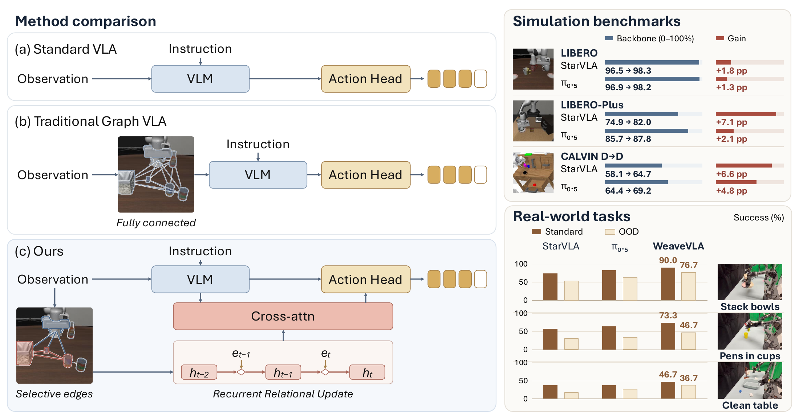
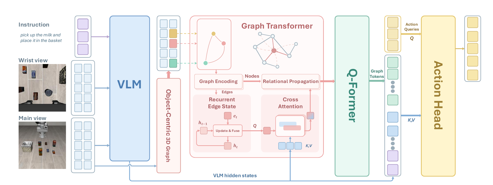

<div align="center">
  <h1>WeaveVLA</h1>
  <p><strong>3D Relational Grounding for Vision-Language-Action Models</strong></p>

  <p>
    <a href="https://arxiv.org/abs/2611.31126"></a>
    <a href="https://kingzein.github.io/weave-vla/#overview"></a>
    <a href="https://huggingface.co/Kensag/WeaveVLA"></a>
  </p>

  <p>
    <a href="#overview">Overview</a> · <a href="#performance">Results</a> · <a href="#getting-started">Getting Started</a> ·
    <a href="#training">Training</a> · <a href="#evaluation">Evaluation</a>
  </p>

  
</div>

## Overview

WeaveVLA builds a graph of objects and their 3D relations from camera observations. Recurrent edge memory tracks relations over time. The graph exchanges features with the vision-language context, and a Q-Former condenses those features into tokens for action generation.

The [StarVLA](starvla/) and [π0.5](pi05/) implementations include training and evaluation launchers for LIBERO and CALVIN D→D.

<details>
<summary>Model architecture</summary>



</details>

## Performance

Bold scores mark WeaveVLA results that match the highest success rate in their column.

### LIBERO

We evaluate 50 trials per task across four suites, with 500 rollouts per suite. The table shows selected success rates (%) from Table 1 of the paper. Long denotes LIBERO-10, and Avg. is the mean across the four suites.

| Method | Spatial | Object | Goal | Long | Avg. |
| --- | ---: | ---: | ---: | ---: | ---: |
| OpenVLA-OFT | 97.6 | 98.4 | 97.9 | 94.5 | 97.1 |
| VLA-JEPA | 96.2 | 99.6 | 97.2 | 95.8 | 97.2 |
| StarVLA-GR00T | 97.8 | 98.8 | 97.4 | 92.0 | 96.5 |
| π0.5 | 98.8 | 98.2 | 98.0 | 92.4 | 96.9 |
| **WeaveVLA (StarVLA)** | 98.8 | **99.6** | **98.8** | 96.0 | **98.3** |
| **WeaveVLA (π0.5)** | **99.0** | 99.2 | 98.2 | **96.4** | 98.2 |

### Zero-Shot Robustness on LIBERO-Plus

We evaluate the LIBERO-trained checkpoints once per instance across all **10,030 instances** and seven perturbation categories. The table shows success rates (%) from Table 2 of the paper. Overall success is pooled across all trials, and the StarVLA-GR00T baseline is our reproduction.

| Method | Camera | Robot | Language | Light | Background | Noise | Layout | Overall |
| --- | ---: | ---: | ---: | ---: | ---: | ---: | ---: | ---: |
| Fast-WAM | 16.4 | 44.5 | 68.9 | 78.2 | 53.7 | 37.7 | 60.7 | 51.5 |
| π0 | 13.8 | 6.0 | 58.8 | 85.0 | 81.4 | 79.0 | 68.9 | 53.6 |
| VLA-JEPA | 63.3 | 67.1 | 85.4 | 95.6 | 93.6 | 66.3 | 85.1 | 79.5 |
| OpenVLA-OFT | 56.4 | 31.9 | 79.5 | 88.7 | 93.3 | 75.8 | 74.2 | 69.6 |
| Being-H0.7 | 82.0 | 59.0 | 82.8 | 97.8 | 90.0 | 93.5 | 88.5 | 82.1 |
| Cosmos-Policy | 75.8 | 63.3 | 81.7 | 96.5 | 88.9 | 92.7 | 82.2 | 82.2 |
| ImageWAM | 80.8 | 50.3 | 91.4 | 98.1 | 85.5 | 93.8 | 80.5 | 83.1 |
| ABot-M0.5 | 70.5 | 87.4 | 88.6 | 94.0 | 89.7 | 75.5 | 85.2 | 83.4 |
| StarVLA-GR00T | 49.2 | 62.3 | 84.3 | 93.2 | 92.7 | 74.2 | 79.5 | 74.9 |
| π0.5 | 75.4 | 77.5 | 85.6 | 96.9 | 94.6 | 89.7 | 85.7 | 85.7 |
| **WeaveVLA (StarVLA)** | 64.6 | 69.2 | **93.2** | 94.8 | 95.3 | 83.6 | 81.2 | 82.0 |
| **WeaveVLA (π0.5)** | 79.5 | 85.7 | 83.1 | 97.9 | **97.4** | 89.3 | 87.7 | **87.8** |

### CALVIN D→D

Five-subtask success rises from 58.1% to **64.7%** with StarVLA-GR00T and from 64.4% to **69.2%** with π0.5.

The teaser also reports real-world results for bowl stacking, pen placement, and table clearing.

## Getting Started

1. Install the environment for [StarVLA](#starvla) or [π0.5](#π05).
2. Download the [checkpoints and assets](#assets) for your benchmark.
3. Follow [Training](#training) to train from base weights or [Evaluation](#evaluation) to run a trained policy.

### Installation

Create a separate environment for each backend. Training uses Linux, CUDA, and BF16 support. Simulation and perception workers can use separate interpreters.

#### StarVLA

Install FFmpeg and C++ build tools, then run the commands below from the repository root.

```bash
cd starvla
conda create -n weavevla-starvla python=3.10 -y
conda activate weavevla-starvla
python -m pip install torch==2.6.0 torchvision==0.21.0 \
  --index-url https://download.pytorch.org/whl/cu124
python -m pip install -r requirements.txt
python -m pip install -e .
```

#### π0.5

Install [uv](https://docs.astral.sh/uv/) and run the commands below from the repository root.

```bash
cd pi05
uv sync --locked --extra cuda
source .venv/bin/activate
python scripts/install_transformers_patch.py
```

The patch installs the OpenPI model adapter for Transformers 4.53.2. See the [environment notes](pi05/docs/setup.md) for dependency inventories.

### Assets

For training, prepare an audited cache manifest and either the [Qwen3-VL-4B-Instruct backbone](https://huggingface.co/Qwen/Qwen3-VL-4B-Instruct) or the [OpenPI base checkpoint](https://github.com/Physical-Intelligence/openpi#base-models) at `gs://openpi-assets/checkpoints/pi05_base`. The [asset guide](docs/assets.md) covers cache formats and perception dependencies.

#### Download Release Assets

The Hugging Face release includes LIBERO policies with their normalization files and YOLOE detectors for both benchmarks.

| Checkpoint | Download |
| --- | --- |
| StarVLA policy for LIBERO | [Model](https://huggingface.co/Kensag/WeaveVLA/tree/main/starvla/libero) |
| π0.5 policy for LIBERO | [Model](https://huggingface.co/Kensag/WeaveVLA/tree/main/pi05/libero) |
| Fine-tuned YOLOE for LIBERO | [Detector](https://huggingface.co/Kensag/WeaveVLA/tree/main/yolo/libero) |
| Fine-tuned YOLOE for CALVIN | [Detector](https://huggingface.co/Kensag/WeaveVLA/tree/main/yolo/calvin) |

The YOLOE checkpoints load with Ultralytics 8.3.200 and follow the [upstream licensing terms](https://www.ultralytics.com/license).

<details>
<summary>Download commands</summary>

Set `WEAVEVLA_VARIANT=pi05/libero` to select the π0.5 policy.

```bash
python -m pip install huggingface_hub

# Qwen base weights for StarVLA
hf download Qwen/Qwen3-VL-4B-Instruct --local-dir pretrained/Qwen3-VL-4B-Instruct

# LIBERO policy weights and matching inference files
WEAVEVLA_HF_MODEL_REPO="${WEAVEVLA_HF_MODEL_REPO:-Kensag/WeaveVLA}"
hf download "$WEAVEVLA_HF_MODEL_REPO" \
  --include "${WEAVEVLA_VARIANT:-starvla/libero}/*" \
  --local-dir assets/checkpoints
hf download "$WEAVEVLA_HF_MODEL_REPO" \
  yolo/libero/model.pt yolo/calvin/model.pt \
  --local-dir assets/checkpoints

# PaliGemma tokenizer for π0.5
curl -fL --create-dirs \
  https://storage.googleapis.com/big_vision/paligemma_tokenizer.model \
  -o assets/tokenizers/paligemma_tokenizer.model
```

</details>

## Training

### Train with StarVLA

Run from `starvla/`. This backend uses Qwen3-VL-4B and GR00T with DeepSpeed ZeRO-2. Set `NUM_PROCESSES` and `PER_DEVICE_BATCH_SIZE` before launching. Their product is the global batch size.

```bash
# LIBERO
bash examples/LIBERO/train_files/run_train.sh \
  --base-vlm "$QWEN_WEIGHTS" --manifest "$LIBERO_MANIFEST" --output runs/libero

# CALVIN D→D
bash examples/CALVIN/train_files/run_train.sh \
  --base-vlm "$QWEN_WEIGHTS" --manifest "$CALVIN_D_MANIFEST" \
  --prompt-root "$PROMPT_ROOT" --action-stats "$CALVIN_D_STATS" --output runs/calvin_d
```

The action horizon and graph stride are both 8, and the geometry loss weight is 0.1. See the [training configs](starvla/starVLA/config/training/) and [ZeRO-2 settings](starvla/starVLA/config/deepseeds/zero2.json).

### Train with π0.5

Run from `pi05/`. This backend uses JAX for training and a Torch policy adapter for evaluation.

```bash
# LIBERO
python scripts/train.py pi05_libero \
  --base-params "$PI05_BASE/params" --tokenizer "$TOKENIZER" \
  --manifest "$LIBERO_MANIFEST" --output runs/libero

# CALVIN D→D
python scripts/train.py pi05_calvin_d \
  --base-params "$PI05_BASE/params" --tokenizer "$TOKENIZER" \
  --manifest "$CALVIN_D_RAW_MANIFEST" --prompt-root "$PROMPT_ROOT" --output runs/calvin_d
```

| Configuration | Global batch | Action horizon | Graph stride | Geometry loss weight |
| --- | ---: | ---: | ---: | ---: |
| [`pi05_libero`](pi05/src/weavevla/training/config.py) | 256 | 10 | 8 | 0.1 |
| [`pi05_calvin_d`](pi05/src/weavevla/training/config.py) | 48 | 8 | 8 | 0.1 |

The default run uses 30,000 steps and warms up for 10,000 steps to a learning rate of 5×10⁻⁵. Set the model-sharding axis with `--fsdp-devices`.

Both training backends write metrics to `metrics.jsonl` and record model and training settings in the run directory. Supply local input directories and asset paths through the launch commands.

## Evaluation

| Backend | LIBERO | CALVIN D→D |
| --- | --- | --- |
| StarVLA | [Launcher](starvla/examples/LIBERO/eval_files/run_eval.sh) | [Launcher](starvla/examples/CALVIN/eval_files/run_eval.sh) |
| π0.5 | [Launcher](pi05/examples/libero/main.py) | [Launcher](pi05/examples/calvin/main.py) |

See the [evaluation guide](docs/evaluation.md) for checkpoints and commands.

## Citation

```bibtex
@misc{wang2026weavevla3drelationalgrounding,
  title         = {WeaveVLA: 3D Relational Grounding for Vision-Language-Action Models},
  author        = {Zien Wang and Yuhao Pan and Yunfeng Fan and Nan Cheng and Xin Xia and Wenchao Xu},
  year          = {2026},
  eprint        = {2611.31126},
  archivePrefix = {arXiv},
  primaryClass  = {cs.RO},
  url           = {https://arxiv.org/abs/2611.31126}
}
```

## Acknowledgements

WeaveVLA builds on [StarVLA](https://github.com/starVLA/starVLA) and [OpenPI](https://github.com/Physical-Intelligence/openpi).

## License

See the [StarVLA license](starvla/LICENSE), [OpenPI license](pi05/LICENSE), and [Gemma terms](pi05/LICENSE_GEMMA.txt) for the bundled components.
